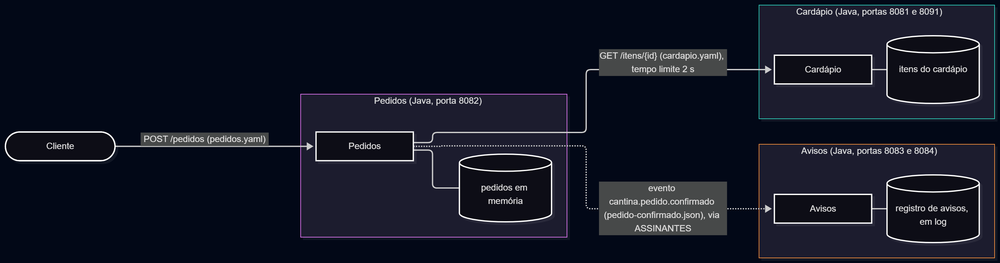

# Cantina SOA

Laboratório SOA da Cantina: três serviços independentes (Cardápio, Pedidos e Avisos) com contratos OpenAPI, composição por HTTP e eventos CloudEvents. Checkpoint de Arquitetura Orientada a Serviços e Web Services, FIAP.

- **Grupo:** Renan Dias Utida (RM 558540), trabalho individual
- **Linguagens:** Java 25 com Spring Boot nos três serviços, mais um Cardápio alternativo em Python 3 usado só na prova de fogo
- **Trilha de eventos:** Trilha A, sem broker, com a variável `ASSINANTES`

## Como rodar

Requisitos: Java 25, Maven 3.9 ou superior e `curl`. Foi testado no GitHub Codespaces.

Na raiz do repositório:

```bash
./subir-servicos.sh
```

O script compila o que ainda não estiver compilado, derruba processos antigos, sobe os serviços e espera cada um responder `200` em `/saude`. Os logs ficam em `/tmp`.

| Serviço | Porta | Variáveis de ambiente |
|---|---|---|
| Cardápio | 8081 e 8091 (duas instâncias) | `PORTA` |
| Pedidos | 8082 | `PORTA`, `CARDAPIO_URL`, `ASSINANTES` |
| Avisos | 8083 (e 8084, opcional) | `PORTA`, `INSTANCIA` |

Criar um pedido e ver o aviso:

```bash
curl -i -X POST http://localhost:8082/pedidos -H "Content-Type: application/json" --data @evidencias/pedido.json
grep confirmado /tmp/avisos-8083.log
```

Ligar um segundo consumidor, só por configuração:

```bash
cd servicos/avisos
PORTA=8084 INSTANCIA=avisos-8084 setsid nohup java -jar target/avisos-0.0.1-SNAPSHOT.jar > /tmp/avisos-8084.log 2>&1 &
cd ../pedidos
pkill -f pedidos-0.0.1
PORTA=8082 CARDAPIO_URL=http://localhost:8081 ASSINANTES=http://localhost:8083/eventos,http://localhost:8084/eventos setsid nohup java -jar target/pedidos-0.0.1-SNAPSHOT.jar > /tmp/pedidos.log 2>&1 &
```

Parar tudo:

```bash
pkill -f "cardapio-0.0.1|avisos-0.0.1|pedidos-0.0.1"
```

## Arquitetura



A visão de sequência, as decisões do projeto e os pontos de falha estão em [`arquitetura/arquitetura.md`](arquitetura/arquitetura.md). Os arquivos-fonte dos desenhos (Mermaid) ficam em `arquitetura/mermaid/` e as imagens em `arquitetura/img/`.

## Matriz de princípios

| Princípio | Onde aparece no projeto | Evidência |
|---|---|---|
| Contrato padronizado | Os três contratos (`cardapio.yaml` e `pedidos.yaml` em OpenAPI 3, `pedido-confirmado.json` em CloudEvents) foram escritos e commitados antes de existir código de serviço. | `contratos/` e a tag `entrega-1` |
| Baixo acoplamento | O Pedidos conhece o Cardápio só pelo contrato e pelo endereço em `CARDAPIO_URL`, e conhece o Avisos só pelo evento. Trocar o Cardápio Java por um em Python não exigiu mudar nenhuma linha. | `CardapioClient.java` e `evidencias/missao3.txt` |
| Abstração | O Pedidos só enxerga o que o contrato do Cardápio expõe e ignora o que não conhece, como o campo extra `categoria` do Cardápio em Python. | `ItemCardapio.java` (leitor tolerante) e a prova de fogo |
| Reuso | O mesmo Pedidos funcionou com dois Cardápios diferentes (Java e Python), e o mesmo evento alimentou duas instâncias do Avisos sem alterar código. | `evidencias/missao3.txt` e `evidencias/missao4.txt` |
| Autonomia | Cada serviço é um projeto e um processo próprios, com seus dados (`CardapioRepository`, `PedidoRepository`, log do Avisos). O Pedidos continua respondendo com o Cardápio fora (503 em 0,016 s) ou com o Avisos fora (201). | `servicos/`, `evidencias/missao3.txt` e `evidencias/missao4.txt` |
| Ausência de estado | Duas instâncias do Cardápio (8081 e 8091) respondem igual, e nenhuma guarda nada de quem chamou. | `evidencias/missao2.txt` |
| Descoberta | A pasta `contratos/` é o catálogo: dá para saber como chamar cada serviço sem ler o código. Os endereços vêm de configuração (`CARDAPIO_URL`, `ASSINANTES`, `PORTA`). | `contratos/` e o `application.properties` de cada serviço |
| Composição | O `POST /pedidos` combina o Cardápio (preço e disponibilidade) com a regra de total do Pedidos e ainda publica um evento para o Avisos. | `PedidosController.java` e `PublicadorDeEventos.java` |

## Prova de fogo (Missão 3)

O Pedidos (Java, Spring Boot) foi apontado, apenas pela variável `CARDAPIO_URL` e sem alterar nenhuma linha de código, para um Cardápio alternativo em **Python 3** (biblioteca padrão), no arquivo `evidencias/prova-de-fogo/cardapio_python.py`.

Nenhum outro aluno estava fazendo este checkpoint, por isso a prova foi feita com um Cardápio alternativo em outra linguagem, e não com o de outro grupo. Ele segue o mesmo `contratos/cardapio.yaml` e devolve um campo extra (`categoria`), que o Pedidos ignora.

Resultado: o `POST /pedidos` devolveu `201` com `totalCentavos` 2500, e o pedido com o Bolo de cenoura devolveu `422`, igual ao Cardápio em Java. A saída está em `evidencias/missao3.txt`.

## Eventos e Avisos (Missão 4)

**Trilha escolhida: A (sem broker).** O Pedidos, depois de confirmar um pedido, publica o evento `cantina.pedido.confirmado` (envelope CloudEvents, igual a `contratos/pedido-confirmado.json`) com um `POST` para cada endereço da variável de ambiente `ASSINANTES`, uma lista separada por vírgulas. O Avisos expõe `POST /eventos` (porta 8083) e registra uma linha como `Pedido 1 confirmado, total R$ 25,00`.

Escolhi a Trilha A porque prova os mesmos princípios (o Pedidos não sabe quem escuta e não espera resposta) sem exigir infraestrutura extra, como um broker, o que cabia melhor no prazo.

- **O pedido não depende do aviso:** a entrega do evento roda em segundo plano e qualquer falha só vira um aviso no log do Pedidos. Com o Avisos fora do ar, o `POST /pedidos` continua devolvendo `201`.
- **Novo consumidor só por configuração:** uma segunda instância do Avisos (porta 8084) passou a receber os eventos apenas acrescentando seu endereço em `ASSINANTES`, sem alterar o código do Pedidos.

As saídas dos testes estão em `evidencias/missao4.txt`.

## Evidências por entrega

| Entrega | Tag | Evidência |
|---|---|---|
| 1. Contratos | `entrega-1` | `contratos/` |
| 2. Cardápio | `entrega-2` | `evidencias/missao2.txt` |
| 3. Pedidos | `entrega-3` | `evidencias/missao3.txt` |
| 4. Avisos e eventos | `entrega-4` | `evidencias/missao4.txt` |
| 5. Arquitetura e fechamento | `entrega-5` | `arquitetura/` e este README |