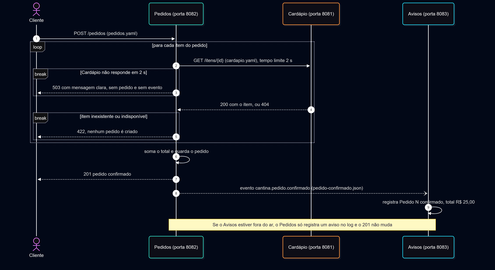

# Arquitetura da Cantina

Os desenhos foram feitos em Mermaid. Os arquivos-fonte são `estrutura.mmd` e `sequencia.mmd`, e as imagens são `estrutura.png` e `sequencia.png`. A visão de estrutura cresceu a cada entrega.

## Visão de estrutura

Linha contínua: chamada síncrona. Linha tracejada: evento. Cada seta leva o nome do contrato, e cada serviço aparece com os dados que são só dele.

## Visão de sequência de um pedido

Mostra o pedido do início ao fim e os dois caminhos de falha: o Cardápio que não responde em 2 segundos (503) e o item inexistente ou indisponível (422).

## Decisões do projeto

| Decisão | Escolha |
|---|---|
| Linguagem | Java 25 com Spring Boot nos três serviços. Um Cardápio alternativo em Python 3 foi usado só na prova de fogo. |
| Portas | Cardápio 8081 e 8091, Pedidos 8082, Avisos 8083 e 8084. A porta de cada processo vem da variável `PORTA`. |
| Onde ficam os dados | Cardápio: lista fixa em memória (`CardapioRepository`). Pedidos: pedidos em memória (`PedidoRepository`). Avisos: sem armazenamento, só o registro em log. Nenhum serviço acessa os dados de outro. |
| Trilha de eventos | A, sem broker. O Pedidos envia o evento por POST a cada endereço da variável `ASSINANTES`, em segundo plano. Escolhida por não exigir infraestrutura extra. |
| Configuração | `PORTA`, `CARDAPIO_URL`, `ASSINANTES` e `INSTANCIA`. Nenhum endereço fica escrito no código. |
| Ferramenta de desenho | Mermaid, com os arquivos-fonte versionados junto do código. |

## Pontos de falha

| Falha | O que acontece | Evidência |
|---|---|---|
| Cardápio fora do ar | O Pedidos responde 503 com mensagem clara em até 2 segundos, sem criar pedido e sem publicar evento. | `evidencias/missao3.txt` |
| Item inexistente ou indisponível | O Pedidos responde 422 e nenhum pedido é criado. | `evidencias/missao3.txt` |
| Avisos fora do ar | O pedido continua devolvendo 201. O evento daquele pedido não é entregue e o Pedidos registra um aviso no log. | `evidencias/missao4.txt` |
| Reinício do Pedidos | Os pedidos guardados em memória são perdidos. É uma limitação consciente do laboratório. | |
| Evento perdido | Na Trilha A não há fila, então um evento não entregue não é reenviado. Um broker resolveria isso (Trilha B). | `evidencias/missao4.txt` |
| Nova assinatura | A variável `ASSINANTES` só é lida quando o Pedidos sobe, então um novo consumidor exige reiniciar o Pedidos, sem mudar o código. | `evidencias/missao4.txt` |